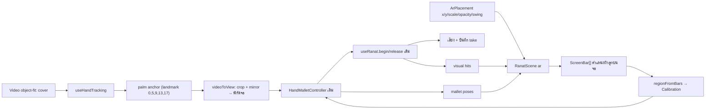

# Ranat Next — AR ซ้อนภาพกล้อง

วันที่ 20 ตุลาคม 2026 · สถานะ: ทดลอง (เพิ่มจากโหมด “เล่นด้วยมือ” เดิม ไม่แทนที่)

## เป้าหมาย

ผู้เล่นเห็นระนาด 3D วางอยู่บนภาพกล้องจริง (เช่น บนโต๊ะตรงหน้า) แล้วตีลงที่ลูกที่เห็นในภาพ ไม่ต้องมองภาพกล้องเล็กกับระนาดคนละจอแบบโหมดเล่นด้วยมือ

ขอบเขตรุ่นนี้คือ **camera overlay**: ระนาดอยู่ในตำแหน่งบนจอที่ผู้เล่นจัดไว้ ยังไม่ตรวจพื้นผิวหรือยึดกับโต๊ะจริงเมื่อขยับกล้อง (WebXR/hit-test เป็นงานระยะถัดไปตาม `docs/3d-instrument-interaction-plan.md`)

## เข้าใช้งาน

`/instruments/ranat/play` → แถบวิธีเล่นเลือก **AR (ทดลอง)** → เปิดกล้อง AR → (ถ้าต้องการ) จัดตำแหน่งระนาด → เริ่มจับมือ

- ยกฝ่ามือเหนือเส้นเขียว เลื่อนซ้าย–ขวาให้อยู่เหนือลูกที่ต้องการ แล้วลดมือลงถึงเส้นทอง (ระดับผิวลูกระนาดในภาพ) เพื่อตี
- เล่นช่วงละ 8 ลูกตามตัวเลือกช่วงเสียงเดิม (ต่ำ/กลาง/สูง); ลูกนอกช่วงจางลง
- แตะลูกบนภาพ ปุ่มเลข และคีย์บอร์ดยังใช้ได้ระหว่าง AR
- สลับกล้องหน้า/หลังได้ กล้องหน้าแสดงแบบกระจก

## Data flow

หลักสำคัญ: **พื้นที่เล่นมาจากตำแหน่งลูกระนาดที่วาดจริง** ไม่ใช่การตั้งพื้นที่แยก ฉาก 3D ฉายจุดกลางผิวบนของลูก 21 ลูกลงพิกัดจอ (0–1) ทุกครั้งที่ขนาดจอ ช่วงเสียง หรือการจัดวางเปลี่ยน แล้ว `regionFromBars` สร้าง `Calibration` ให้ controller เดิม จึงได้ state machine, hysteresis, watchdog และกติกากันโน้ตซ้ำชุดเดียวกับโหมดเล่นด้วยมือ

## พิกัด

- `videoToView`: แปลงจุด MediaPipe (สัดส่วนของเฟรมวิดีโอ) เป็นสัดส่วนของ stage ที่แสดงวิดีโอแบบ `object-fit: cover` และกลับซ้ายขวาเมื่อเป็นกล้องหน้า (สูตรเดียวกับ `lib/hand-tracking/drawing.ts` ที่วาดโครงมือ)
- กล้อง 3D: orthographic มุมผู้เล่นเดิม (สูง 1.35, ห่าง 1.9) เลื่อนแกน x ไปกลางช่วง 8 ลูก; `zoom` ทำให้ 8 ลูกกว้าง `scale` × ความกว้างจอ; `setViewOffset` วางกลางช่วงที่ `(x, y)` ของจอ raycast ของการแตะใช้ projection เดียวกันจึงตรงกับภาพ
- `regionFromBars`: left/right = กึ่งกลางลูกแรก/สุดท้าย ± ครึ่งระยะห่างลูก; เส้นตี (v = .62) = ค่าเฉลี่ย y ของผิวลูก 8 ลูก; ระยะยกมือ `swing` (สัดส่วนความสูงจอ) ลดลงอัตโนมัติถ้าใกล้ขอบภาพ
- คืนเหตุผลแทน calibration เมื่อเล่นไม่ได้: ลูกล้นขอบภาพ (`offscreen`), ระนาดเล็กกว่า 18% ของความกว้าง (`too-small`), ไม่มีที่ยกมือ (`no-room`) และปิดปุ่มเริ่มจับมือพร้อมข้อความ

## การจัดวางและการเก็บข้อมูล

- `ArPlacement = { x, y, scale, opacity, swing }` ค่าเริ่มต้น `.5, .66, .86, .92, .3`
- จัดตำแหน่ง: ลากบนภาพ หรือโฟกัสพื้นที่แล้วกดลูกศร (Shift = ทีละ 5%) และ slider ขนาด/ความชัด/ระยะยกมือ; บันทึก/ยกเลิก/ค่าเริ่มต้น
- เก็บใน `localStorage["ranat-next:ar-placement:v1"]` แบบ `{ version: 1, placement }`; ข้อมูลเสียหรือค่าเกินช่วงถูก clamp รายช่อง; เก็บไม่ได้ก็ใช้ค่าชั่วคราวต่อ
- ระหว่างจัดตำแหน่งหยุดการจับมือและไม่สร้างเสียงจากมือ

## Lifecycle

เหมือนโหมดเล่นด้วยมือ: เปิดกล้องเมื่อผู้ใช้กด, เริ่มจับมือหลัง unlock เสียง, blur/ซ่อนแท็บ/เปลี่ยนโหมด เทคนิค ช่วงเสียง ความไว กล้อง หรือเข้าโหมดจัดตำแหน่ง → พักและต้องกดเริ่มใหม่, watchdog ยกเลิก hold เมื่อเฟรมหาย > 180 ms, playback พักการจับมือ, สลับไปโหมดอื่นปิดกล้องและ landmarker โดย unmount, WebGL ใช้ไม่ได้แสดงข้อความและยังเล่นด้วยปุ่ม/คีย์บอร์ดได้

## ไฟล์

| ไฟล์ | หน้าที่ |
| --- | --- |
| `src/instruments/ranat/ar.ts` | pure logic: placement parse/clamp, `videoToView`, `regionFromBars` |
| `src/components/ranat/RanatArCamera.tsx` | UI/lifecycle ของโหมด AR |
| `src/components/ranat/RanatScene.tsx` | prop `ar`: จัดกล้องตาม placement และรายงานตำแหน่งลูกบนจอ |
| `src/components/ranat/ranat-3d.css` | สไตล์ `.rn-ar-*` ใช้โทนสี/มุมโค้งเดิมของระนาด |
| `tests/ranat-ar.test.mjs` | placement, cover/mirror mapping, region, ขอบจอ และการตีลูกที่เห็นบนภาพ |

## ผลตรวจรอบนี้

- `npm test` 48/48, `npm run typecheck` และ `npm run lint` ผ่าน (รันบน Linux VM ของเครื่องผู้พัฒนา)
- ตรวจ projection ด้วย three r186 headless (SwiftShader): จุดที่ฉายตรงกลางลูกระนาดที่ render จริงทั้งจอ 1200×675 และ 360×480 และ 8 ลูกกว้าง `scale` ของจอพอดี
- **ยังไม่ได้ตรวจ**: `npm run build` (VM ไม่มี SWC สำหรับ Linux — ต้องรันบน Windows), หน้าเว็บจริงใน browser, กล้องและมือจริง, ความหน่วง, มือถือจริง

## งานถัดไป

1. ทดลองมือจริงบนโต๊ะทั้งกล้องหน้า/หลัง ปรับค่าเริ่มต้น `swing`/ความไว
2. ใช้ความลึกของมือ (ขนาดฝ่ามือในภาพ) ช่วยแยก “เหนือลูก” กับ “ลงถึงลูก” เมื่อกล้องมองจากด้านหน้า
3. แยก session logic ที่ซ้ำกับ `RanatCamera` เป็น hook ร่วมหลังผ่านการทดลองจริง
4. WebXR hit-test วางระนาดบนโต๊ะจริง เฉพาะอุปกรณ์ที่ทดสอบแล้ว
