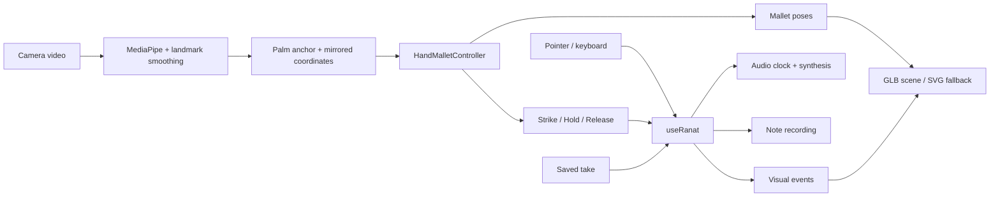
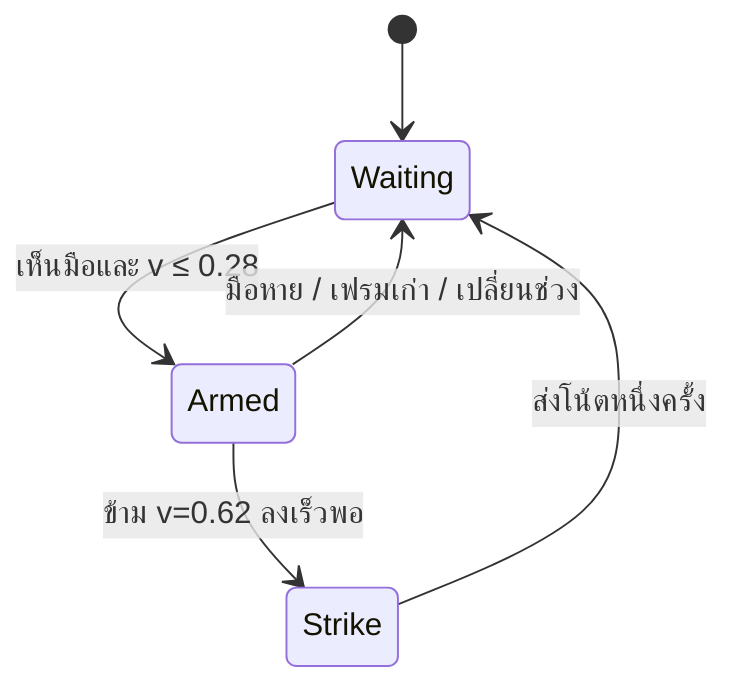

# Ranat Next — ระบบเล่นด้วยมือและโมเดล 3D

วันที่ 2 ตุลาคม 2026

## เป้าหมายและขอบเขต

หน้าต่างระนาดเดียวกันรองรับสัมผัส คีย์บอร์ด และการเล็ง/ตีด้วยมือผ่านกล้อง โมเดลระนาดแยกลูกและไม้สองข้าง ใช้เสียงและข้อมูลบันทึกชุดเดิม รวมทั้งนำ GLB เดียวกันไปแสดงเคลื่อนไหวในหน้า showcase

รุ่นนี้เป็น hand-controlled virtual instrument: ภาพกล้องเป็น preview เล็ก ผู้เล่นมองระนาดบนจอ ไม่จำเป็นต้องเห็นตัวเองเต็มหน้าจอ ยังไม่มีการตรวจพื้นผิวหรือตรึงระนาดกับโต๊ะจริง ชื่อผู้ใช้คือ “เล่นด้วยมือ”

ใช้ภาพ reference.png ที่ผู้ใช้ส่งเป็นแนวทาง: รางโค้งสีน้ำตาลเข้ม ปลายเชิด ขอบทอง ลูกระนาดไม้ และหัวไม้สีดำ ผลงานที่สร้างเป็นโมเดลต้นแบบของโปรเจกต์ ไม่ใช่การสแกนเครื่องจริงหรือสำเนารายละเอียดแกะสลักครบทุกจุด ขนาดในโมเดลเป็นสัดส่วนต้นแบบ ต้องวัดเพิ่มก่อนใช้ AR มาตราส่วนจริง

## วิเคราะห์ระบบเดิมและการตัดสินใจ

| ระบบเดิม | ปัญหาสำหรับประสบการณ์ใหม่ | สิ่งที่ทำ |
| --- | --- | --- |
| RanatSurface เป็น SVG | ไม้เปลี่ยนตำแหน่งเมื่อมีเสียงเท่านั้น | เพิ่ม GLB และ RanatScene; SVG เป็น fallback |
| RanatCamera แยกใต้พื้นที่เล่น | ผู้ใช้มองสองบริเวณ มือกับไม้ไม่สัมพันธ์ต่อเนื่อง | ย้าย controller + preview + ระนาดเข้าภายใน stage เดียว |
| CameraStrike รับเพียงความสูงมือ | ไม่มีตัวจัดการเล็ง ลูกข้างเคียง และ identity jump ร่วมกัน | เพิ่ม HandMalletController แบบ pure TypeScript |
| hits เก็บล่าสุดต่อมือ | โน้ตเร็ว/ตีหลายลูกอาจหายจากข้อมูลภาพ | เก็บเหตุการณ์ภาพช่วง 400 ms สูงสุด 32 รายการ พร้อม id |
| เสียงและการบันทึกมีอยู่แล้ว | การสร้างเสียงอีกเส้นทางทำให้โน้ตซ้ำ | ทุก input ส่งเข้า useRanat.begin/emit เดิม |
| การตั้งพื้นที่กดปุ่มทันที | มือเคลื่อนกลับเมาส์ทำให้จับตำแหน่งผิด | ปุ่มนับถอยหลัง 2 วินาทีก่อนรับตำแหน่ง |
| Next/React มีอยู่แล้ว | ไม่จำเป็นต้องแยกแอปใหม่ | Client Component + dynamic import ตามคู่มือ Next ในโปรเจกต์ |

## Data flow

เสียงเป็นผู้กำหนดจังหวะ ภาพไม้ชนไม่เรียกเล่นเสียงอีกครั้ง เสียงที่นัดไว้ใช้ clock ของ audio และ visual event ถูกส่งใกล้เวลาเดียวกันโดย timer ห้ามอ้างว่าเป็น sample-accurate visual synchronization เพราะ browser timer และจอภาพมีความหน่วงได้

## โมเดลข้อมูลและขอบเขตความรับผิดชอบ

- **PalmSample**: hand L/R, x/y 0–1, confidence เป็น input ที่ไม่ผูกกับ MediaPipe class ทำให้ทดสอบด้วยลำดับจุดได้
- **MalletPose**: hand, target bar, u/v, armed, stamp เป็นสถานะที่ renderer ใช้ ไม่ใช่คำสั่งเสียง
- **MalletCommand**: strike(bar, velocity, hand, owner), hold(bar, hand, owner), release(owner)
- **RanatEvent**: ใช้ schema v1 เดิม บันทึก bar, onsetMs, velocity, hand, source, assisted; ไม่บันทึกวิดีโอหรือ landmarks
- **Visual hit**: bar, hand, stamp, id ใช้ทั้งการเล่นสดและ playback; หลายโน้ตอาจสั่นพร้อมกันแม้มีไม้ภาพเพียงสองอัน
- **RanatScene**: โหลด/clone asset ต่อ instance, ปรับไม้และวัสดุใน frame loop, ไม่แปลท่ามือและไม่สร้างเสียง
- **RanatCamera**: ดูแล permission, lifecycle, calibration, ความไว และแปลง tracked hands เป็น PalmSample

## พิกัดและการเล็ง

ใช้ค่าเฉลี่ย landmark 0, 5, 9, 13, 17 เป็นจุดกลางฝ่ามือเพื่อให้ไม้ไม่สั่นตามนิ้วที่ขยับ แปลงกล้องหน้า x เป็น 1−x ให้ตรงกับภาพกระจก preview ไม่ crop วิดีโอ ใช้ aspect ratio จาก metadata

พื้นที่เริ่มต้น: left=.12, right=.88, raised=.22, lowered=.78 สามารถตั้งใหม่ 4 ขั้นได้

สูตร: u=(x−left)/(right−left), v=(y−raised)/(lowered−raised)

- กล้องเล่น 8 ลูกในช่วงต่ำ/กลาง/สูงที่เลือก; bar=start+floor(u×8) โดยขอบขวาสุดยังเป็นลูกที่ 8
- นอกขอบซ้าย/ขวาหรือ v นอก −.4 ถึง 1.4 ให้ไม่มี target ไม่ clamp มือไกลนอกพื้นที่เข้ามาตี
- เมื่ออยู่ใกล้รอยต่อลูก เดิมยังล็อกเป้าหมายไว้เกินขอบได้ 12% ของหนึ่งช่อง ช่วยลดการกระพริบสลับโน้ต
- โมเดล 3D คงรูปทรงจริง 21 ลูก เมื่อเลือกเล่น 8 ลูกจะลดความเด่นของลูกนอกช่วง ไม่ยืดลูกไม้เพื่อเติมราง
- Rendering เลื่อนหัวไม้ไปหา target แบบนุ่มนวล ยกสูงตาม v ส่วนเสียงใช้ target จาก controller ทันที

## State machine ของการตี

- ต้องยกก่อนตี; การเข้าฉากด้วยมือต่ำจะไม่ดัง
- มีความเร็วขั้นต่ำ .9−sensitivity×.65 หน่วย v ต่อวินาที; ค่าเริ่มต้น sensitivity=.5
- เวลาเว้นระหว่างการตีของมือเดียวอย่างน้อย 95 ms; สองมือใช้สถานะแยก จึงตีพร้อมกันได้
- หลังตี armed=false ต่อให้ค้างมือด้านล่างก็ไม่ดังซ้ำ ต้องกลับ v≤.28 ก่อน
- เฟรมขาดเกิน 180 ms, เวลาไม่เดินหน้า, หรือจุดมือกระโดดไกลกว่า .4 ของภาพ จะเริ่มจับใหม่โดยไม่ต่อจังหวะเดิม
- confidence ต่ำกว่า .55 ไม่รับ และกรณีสองมือถูกจัดเป็น side เดียวกันหยุดทั้งคู่จนกลับมาแยกได้
- ความเร็วจากภาพใช้ปรับ velocity .45–1 เป็นการประมาณการเคลื่อนไหว ไม่ใช่แรงกดจริง

## โหมดบรรเลง

| โหมด | มือควบคุม | เงื่อนไข |
| --- | --- | --- |
| ตีเอง | สองมืออิสระ | แต่ละมือยก–ตี สร้างหนึ่งโน้ต |
| ตีคู่ | มือเดียวเลือกฐาน | หนึ่ง strike สร้างคู่เสียงผ่าน runtime เดิม |
| กรอช่วย | มือเดียวเลือกฐาน | ยกเตรียม แล้วลดค้าง 180 ms จึงเริ่ม; ยก/มือหายเพื่อหยุด |
| รัวเสียงเดียว | มือเดียวเลือกฐาน | เหมือนกรอ แต่สลับไม้บนลูกเดียว |

ถ้าพบสองมือในโหมดช่วย ให้หยุด pattern ป้องกันเสียงซ้ำ ใช้ owner camera-hold เพียงตัวเดียว การเปลี่ยน target ขณะกรอใช้ pendingBase ของ runtime เดิมและเปลี่ยนตอนเริ่มรอบคู่

โหมดช่วยแปลง pose ของมือจริงหนึ่งข้างเป็นไม้เสมือนสองข้าง: ไม้ซ้ายอยู่โน้ตฐาน ไม้ขวาอยู่คู่เสียง (หรืออยู่ลูกเดียวกันในโหมดรัว) เสียงและ event คู่มาจาก runtime เดิม

## Lifecycle และการกู้คืน

- เปิดกล้องหลังผู้ใช้กด; เปิดเสียงหลัง gesture ที่เรียก unlock
- ผู้ใช้กดเริ่มจับมือเมื่อ tracker พร้อมเท่านั้น มีการเล็งแบบ default โดยไม่บังคับตั้งพื้นที่ทุกครั้ง
- blur / ซ่อนแท็บ / เปลี่ยนโหมด เทคนิค ช่วงเสียง หรือความไว จะ pause และต้องกดเริ่มใหม่
- watcher ตรวจเฟรม stale ทุก 60 ms จึงยกเลิก hold ภายในประมาณ 180–240 ms หลังเฟรมสุดท้าย
- เมื่อเล่นบันทึกย้อนหลังพัก input มือและให้ไม้แสดงโน้ตจาก playback; เมื่อจบต้องกดเริ่มจับมือใหม่
- เมื่อสลับเป็นสัมผัส component กล้อง unmount และ useCamera ปิด tracks; tracker ปิด landmarker
- หาก permission ถูกปฏิเสธแสดงข้อความและสัมผัส/คีย์บอร์ดยังใช้ได้
- โหลดโมเดลหรือ WebGL ล้มเหลวใช้ SVG fallback; ผู้ใช้เลือกภาพ 2D เองได้
- API detectForVideo ล้มเหลวหยุด loop แจ้งปิด–เปิดกล้องใหม่ ไม่ปล่อย pose เก่าค้าง

## Asset และภาพเคลื่อนไหว

ต้นฉบับ: art/ranat/ranat-next.blend; ไฟล์เว็บ: public/models/ranat-next.glb

- root: ranat_root; ลูก: bar_00…bar_20; ไม้: mallet_L/R มีจุดอ้างอิงอยู่ที่หัวไม้
- ขอบทองและเส้นผูกลูกเป็น geometry; texture ลายไม้สร้างสำหรับโปรเจกต์และ packed ใน GLB
- โมเดลปัจจุบัน673,464 bytes (ประมาณ 674 KB), 17,792 triangles, 5 materials, 1 texture หลัง deduplicate ด้วย glTF Transform
- การตี/สั่นเป็น procedural animation ในเว็บ ไม่ใช่ baked clip; ไฟล์ GLB เพียงอย่างเดียวจะไม่เล่นโน้ตหรือขยับตามมือ
- ทุก instance clone scene/material ที่แก้ไข เพื่อไม่ให้ showcase ไปเปลี่ยนสถานะหน้าเล่น
- ใช้ demand rendering, DPR สูงสุด 1.5 และหยุด animation เมื่ออยู่นอก viewport/ซ่อนแท็บ; showcase โหลดเมื่อมองเห็น
- reduced-motion ปิดการโยกและการสั่นตกแต่ง แต่ยังแสดงตำแหน่งและ highlight

## การทดสอบและสิ่งที่ยังต้องวัด

การตรวจอัตโนมัติแยกสามชั้น:

1. pure controller: สองมือ, ค้าง, missing/low confidence, side ซ้ำ, jump, stale frame, hysteresis, hold release, เปลี่ยนช่วง, การตั้งพื้นที่กลับด้าน
2. browser: โหลด GLB, กดตัวโมเดลโดยตรง, ปุ่มโน้ต, คีย์บอร์ด, สองนิ้วพร้อมกัน, บันทึก/เล่นย้อนหลัง, กล้องจำลอง, calibration ไม่มีมือ, fallback 2D, showcase และหน้าจอ 390 px
3. build/typecheck/lint รวมโปรเจกต์และ tests เดิม

กล้องจำลองพิสูจน์การเปิด stream และ initialization ของ MediaPipe แต่ไม่พิสูจน์ความแม่นกับมือจริง รูปมือจริง แสง ระยะกล้อง handedness เมื่อไขว้มือ และความหน่วงเสียงยังต้องทดสอบกับอุปกรณ์เดโมจริง ผล FPS ของ fake camera ไม่ใช่ performance benchmark

การตรวจด้วยคนก่อนนำเสนอ: มือเดียวไล่ครบ 8 ลูก → สองมือตีสลับ → สองมือตีพร้อม → ค้างมือต่ำ → เอามือออกและกลับเข้าต่ำ → เปลี่ยนช่วง → กรอและยกเพื่อหยุด → บันทึกและฟัง → เล่นภายใต้แสงที่สถานที่จริง ใช้หูฟังแบบสายเมื่อวัด latency

## งานถัดไปตามลำดับ

1. ทดลองมือจริงและปรับ threshold/ความไวตามกล้องเดโม; เพิ่ม stable hand identity หากไขว้มือแล้วสลับข้าง
2. ปรับรูปทรง ผิว และลายทองของโมเดลให้ละเอียดตาม reference หลัง interaction ผ่านการลองจริง
3. เพิ่มตัวบอก target บนตัวลูกที่อ่านง่าย และปรับจังหวะภาพไม้คู่จากผลทดลองจริง
4. เพิ่มโมเดลพิณโดยใช้ scene shell และ visual event แนวทางเดียวกัน แต่มี detector และ target string/fret ของพิณเอง
5. พิจารณา surface AR หลังยืนยันอุปกรณ์และข้อกำหนด ไม่ทำให้ความสำเร็จของ hand-play ขึ้นกับ WebXR

## เอกสารเทคนิคที่ใช้

- คู่มือ Next ใน node_modules/next/dist/docs/01-app/02-guides/lazy-loading.md และ 01-getting-started/05-server-and-client-components.md
- https://r3f.docs.pmnd.rs/getting-started/installation
- https://r3f.docs.pmnd.rs/api/canvas
- https://r3f.docs.pmnd.rs/api/hooks
