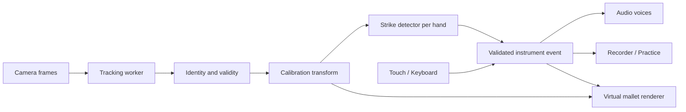

# Ranat Next — แบบระบบละเอียด

สถานะ: ข้อเสนอสำหรับพัฒนา ยังไม่ได้ติดตั้งหรือทดสอบความแม่นยำบนอุปกรณ์จริง

ต่อยอดจาก [ระบบเครื่องดนตรีในเครือ](instrument-platform-design.md) โดยใช้รหัสเครื่อง ranat และแบรนด์ Ranat Next ทุกตัวเลขเกี่ยวกับ tracking/latency ด้านล่างเป็นค่าเริ่มต้นหรือเกณฑ์เป้าหมาย ต้องปรับจากผลทดลอง

ปรับแบบหลังศึกษาเทคนิคการบรรเลง: อ่าน [เทคนิคและระบบช่วยบรรเลง](ranat-next-playing-techniques.md) ประกอบ โดย Compact 7 ลูกในเอกสารนี้เป็นโหมดโน้ตเดี่ยว ไม่รองรับคู่แปดแบบเลือกสองปลายโดยตรง ต้องใช้พื้นที่อย่างน้อย 8 ลูกหรือโหมดช่วยจับคู่ ส่วน hold-to-roll ต้องเปิดเป็นโหมดช่วยชัดเจน แยกจาก detector ตีด้วยมือจริง

## 1. ขอบเขตและข้อสรุปหลัก

หน้าจอแสดงระนาดเอกในมุมคนเล่นตามภาพคอนเซปต์ แต่พื้นที่ที่กล้องจับมือมีขนาดอิสระจากภาพระนาด เป้าหมายคือเล่นได้ด้วยกล้องธรรมดา ไม่พึ่งเลนส์ wide

รุ่นแรกใช้มือเปล่าขยับแทนไม้ตี มีไม้เสมือนบนหน้าจอ การจับไม้ตีจริงเป็นงานอีกระยะหนึ่ง เพราะ hand landmarks ไม่ได้ตรวจพบปลายไม้ การตีด้วยการหมุนข้อมืออย่างเดียวอาจไม่เห็นการเปลี่ยนตำแหน่งมือมากพอ จึงต้องมีคำแนะนำให้ยกและลดมือในท่าที่ผ่านการสอบเทียบ

ไม่อ้างว่าระบบนี้วัดการสัมผัสวัตถุจริงหรือสอนเทคนิคระนาดได้เท่าการเรียนกับเครื่องจริง รุ่นแรกมุ่งการสำรวจเสียงและฝึกโน้ต/จังหวะ

## 2. โหมดใช้งาน

| โหมด | พื้นที่เสียง | Input | เงื่อนไข |
| --- | --- | --- | --- |
| Touch | ครบ 21 ลูกหรือขยายบางช่วง | multi-touch / เมาส์ / keyboard | ใช้ได้โดยไม่เปิดกล้อง |
| Camera Compact | ครั้งละ 7 ลูก; ทดลอง 10 ลูกได้เมื่อแม่นพอ | มือเปล่า 1–2 ข้าง | ค่าเริ่มต้นของกล้อง ผ่านการสอบเทียบ |
| Camera Full | ครบ 21 ลูก | มือเปล่า 1–2 ข้าง | ผ่านการทดสอบเลือกโน้ตที่ขอบและกลางราง |
| Camera Overlay | ตามช่วงที่ผ่านการสอบเทียบ | มือบนภาพกล้อง | ภาพซ้อนแบบ 2D ไม่รับประกันการยึดตำแหน่งในโลกจริง |
| Physical Mallets / World AR | ระยะพัฒนาถัดไป | marker/object tracking หรือ spatial tracking | ไม่เปิด capability จนมีระบบตรวจจับเฉพาะ |

ความสามารถเลือกจากคุณภาพจริง ไม่ตัดสินจากชื่อกล้องว่ามีคำว่า wide หรือไม่ ไม่มี API ที่ควรสมมติว่าจะเลือกเลนส์ 0.5x ได้เหมือนกันทุกเครื่อง ซอฟต์แวร์ไม่สามารถคืนภาพนอกมุมมองเลนส์

## 3. การจัดวางอุปกรณ์

| การจัดวาง | ข้อเสนอ |
| --- | --- |
| จอเดียว + กล้องหน้า | จุดเริ่มต้นที่สะดวก มองจอและให้กล้องเห็นมือได้พร้อมกัน ใช้ขาตั้ง |
| จอเดียว + กล้องหลัง | ให้ดูภาพตัวอย่างและทดสอบระยะเอื้อมก่อน ไม่ตั้งเป็นค่าเริ่มต้น เพราะจอกับเลนส์หันคนละทาง |
| กล้องหลังหันลงจากขาตั้ง | ใช้ได้เมื่อทิศการยก/ตีเห็นเป็นการเคลื่อนในภาพ หากเคลื่อนเข้าหาเลนส์เป็นหลักให้เปลี่ยนมุม |
| กล้องหลัง + จอภายนอก | รองรับการจัดวาง แต่ต้องทดสอบความหน่วงของการแสดงผล ไม่เพิ่ม streaming/network เป็นข้อบังคับของ MVP |
| มือถือถือด้วยมือเดียว | แนะนำ Touch หรือ camera มือเดียว ไม่บังคับให้ถือเครื่องพร้อมตีสองมือ |

ไม่กำหนดระยะวางเป็นเซนติเมตรตายตัว เพราะเลนส์ ขนาดมือ และมุมวางต่างกัน ใช้กรอบภาพกับผลการทดลองเป็นเกณฑ์ การขยับกล้องไกลขึ้นอาจเห็นกว้างขึ้นแต่ทำให้มือต่อพิกเซลเล็กลง จึงต้องตรวจความนิ่งใหม่

## 4. เส้นทางก่อนเริ่มเล่น

1. เปิด Ranat Next เห็นระนาดและปุ่ม เล่นด้วยสัมผัส / เล่นด้วยกล้อง
2. กดเริ่มเพื่อปลดล็อกเสียง เตรียม samples; ขอสิทธิ์กล้องเฉพาะเมื่อเลือกกล้อง ไม่ขอไมโครโฟน
3. แสดงภาพตัวอย่างเต็มเฟรมและตัวเลือกกล้องที่เบราว์เซอร์เปิดให้ใช้ ตรวจ actual settings หลังเปิด
4. ให้มืออยู่ในกรอบที่เว้นขอบประมาณ 8% เป็นค่าเริ่มต้น และขยับไปซ้าย/ขวาในระยะสบาย
5. สอบเทียบพื้นที่ ท่ายก และท่าตี ด้วยมือที่จะใช้จริง
6. ทดสอบตีลูกซ้าย กลาง ขวา และสลับมือ แสดงโน้ตที่ระบบเข้าใจให้ผู้ใช้ตรวจ
7. แนะนำ Compact หรือ Full พร้อมเหตุผล เช่น “พื้นที่นี้เลือก 7 ลูกได้ชัดกว่า”
8. เริ่มเล่น เมื่อเปลี่ยนกล้อง/ความละเอียด/ทิศภาพ/ขาตั้ง ให้ทดสอบหรือสอบเทียบใหม่

สถานะ session: idle → preparing → calibrating → validating → ready → playing → paused → disposed; ทุกสถานะที่เกิด error มีทางเลือกลองใหม่หรือกลับ Touch ข้อมูลที่อัดแล้วต้องยังเก็บได้

## 5. การสอบเทียบและพิกัด

### 5.1 แยกพิกัดสามชุด

- Camera coordinates: ภาพต้นฉบับไม่ mirror พิกัด normalized 0–1 พร้อม frame timestamp
- Play coordinates: u สำหรับเลือกโน้ตซ้าย→ขวา และ v สำหรับทิศยก→ตีที่ได้จากการสอบเทียบ
- Display coordinates: ตำแหน่งระนาดและไม้บนหน้าจอ แปลงจาก play coordinates อีกที

ห้ามใช้ CSS mirror เป็นตัวกำหนด handedness หรือเอาพิกัด canvas ที่ crop แล้วไปเทียบกับ video ตรง ๆ ต้องเก็บ transform ของ rotation, mirror, object-fit และ letterbox ชัดเจน ใช้ contain ในหน้าสอบเทียบเพื่อให้เห็นเฟรมครบ

### 5.2 ขั้นตอนสอบเทียบ

เก็บ palm anchor จากค่าเฉลี่ยข้อมือและโคนนิ้ว 5, 9, 13, 17 เพื่อลดการสั่นจากปลายนิ้ว ให้ผู้ใช้เลื่อนไปซ้าย/ขวาและยก/ตีประมาณ 5 ครั้งต่อมือ ระบบประมาณแกนแนวนอนและแกนตีจากข้อมูลจริง ไม่ถือว่าการตีคือ y เพิ่มเสมอ

สร้าง affine basis จากจุดซ้าย/ขวาและเวกเตอร์การตี แล้วแปลง anchor เป็น u,v หากแกนตีเกือบขนานแกนเลือกเสียง หรือ travel ต่ำกว่าความสั่นอย่างชัดเจน ให้ปรับมุมกล้อง ห้ามสร้างความลึกปลอมด้วยการขยายค่า z

ค่า z ของ hand landmarks อ้างอิงข้อมือ และ world landmarks อ้างอิงศูนย์กลางมือ ไม่ใช่ระนาบระนาดที่ตั้งอยู่ในห้อง จึงไม่ใช้ตัดสินการกระแทกพื้นผิวจริง [MediaPipe Web guide](https://developers.google.com/edge/mediapipe/solutions/vision/hand_landmarker/web_js)

สำหรับฉากที่วางกล้องคงที่ สามารถเพิ่มการเลือกกรอบสี่มุมเพื่อแก้ perspective ภายหลัง แต่ homography ใช้กับระนาบที่กำหนดเท่านั้น มือที่ยกออกจากระนาบยังมีความคลาดเคลื่อน

### 5.3 ประเมินจำนวนลูกที่เล่นได้

วัด jitter ของ u ขณะค้างมือประมาณ 1 วินาที แล้วเลือก 7, 10 หรือ 21 ลูกโดยพิจารณาทั้งความกว้างต่อช่องและผลทดสอบตีจริง ค่าเริ่มต้นสำหรับ prototype: ความกว้างต่อช่องควรมากกว่า jitter p95 ประมาณ 4 เท่า ค่านี้เป็น heuristic ไม่ใช่การรับประกัน

ทดสอบอย่างน้อย 20 ครั้งกระจายซ้าย/กลาง/ขวา เป้าหมายการเปิด Full คือเลือกถูกอย่างน้อย 90% และไม่มี false strike ช่วงอยู่นิ่ง 10 วินาที ถ้าไม่ผ่านให้เสนอ Compact พร้อมให้ลองจัดกล้องใหม่

## 6. Mapping ระนาดและช่วงเสียง

ชุดเสียงกำหนด bars เรียงเสียงต่ำ→สูง แต่ละลูกมี barId, pitchHz, label, sampleId และ geometry ไม่ derive การตั้งเสียงไทยจากสูตร semitone โดยอัตโนมัติ ค่าจริงต้องมาจากชุดเสียงที่ตรวจแล้ว

ใน Compact 7 ลูกแบ่งช่วงเริ่มต้นเป็นลูก 1–7, 8–14 และ 15–21 แสดงรางเต็มพร้อมลดความเด่นของลูกที่ไม่ active และแสดงช่วง active ขนาดใหญ่พอให้เห็นจุดตี บทเรียนเริ่มจากเพลงที่อยู่ในช่วงเดียว

คำนวณ localIndex = floor(u × activeCount) เฉพาะ u ที่อยู่ใน [0,1]; เมื่อ u=1 ใช้ช่องสุดท้าย แล้ว globalIndex = rangeStart + localIndex หากอยู่นอกกรอบให้เป็น invalid ไม่ clamp มือที่หลุดกรอบไปตีลูกขอบ

เพิ่ม hysteresis รอบขอบช่องประมาณ 10–15% ของความกว้างช่องเพื่อให้ cursor ไม่สลับโน้ตจาก jitter และเลือก target ณ จุดข้ามเส้นตี ไม่ล็อกตั้งแต่ยกมือจนไม่สามารถเล็งขณะเคลื่อน

การเปลี่ยนช่วงใช้ปุ่มหรือ keyboard รุ่นแรก เมื่อกล้อง active ให้พักการตรวจตีระหว่างแตะปุ่มและรอมือกลับสภาพยกก่อน re-arm แสดงช่วงใหม่ชัดเจน ใช้ rangeRevision ป้องกัน event เก่าไปตีช่วงใหม่ ไม่มีการเปลี่ยนช่วงเองกลางวลี

## 7. Strike detector

แยก state ต่อ trackId ของมือ ไม่ใช้ตำแหน่งใน array เป็น identity; handedness เป็นเพียงข้อมูลประกอบ ใช้ความต่อเนื่องของตำแหน่ง/ขนาด/เวลาเพื่อจับคู่มือระหว่างเฟรม เมื่อสองมือไขว้แล้วแยกไม่ได้ให้ระงับ strike ชั่วคราว

ลำดับสถานะ: LOST → ACQUIRING → RAISED → STRIKING → RECOVERY → RAISED

| สถานะ | เงื่อนไขและผล |
| --- | --- |
| LOST | ไม่มีมือ/เฟรมเก่า/identity กำกวม ล้าง previous crossing ห้ามสร้างเสียง |
| ACQUIRING | ต้องเห็นมือเสถียรและกลับเหนือเส้น re-arm ก่อน |
| RAISED | มืออยู่เหนือเส้นพร้อมตีและมี travel พอจาก baseline |
| STRIKING | ข้ามเส้นตีในทิศที่สอบเทียบไว้ ความเร็วและระยะผ่านเกณฑ์ target valid; emit ครั้งเดียว |
| RECOVERY | ห้ามตีซ้ำจนยกผ่านเส้น re-arm และพ้นช่วง debounce |

ค่าเริ่มต้น: เส้นตี v=0.65, re-arm v=0.35, cooldown 80ms, ขาดเฟรมเกิน 120ms ต้อง acquire ใหม่ และกลับเข้ากรอบนิ่งประมาณ 100ms ก่อนใช้งาน ปรับค่าโดย frame timestamp ไม่ใช่จำนวนเฟรม ค่า v คือสัดส่วน travel ที่สอบเทียบ ไม่ใช่ทั้งภาพ

เงื่อนไข strike ต้องผ่านทั้ง direction, minimum travel, velocity, current tracking validity และ target validity ใช้ hysteresis+re-arm เป็นตัวกันเสียงซ้ำหลัก ไม่ใช่ cooldown อย่างเดียว มือสองข้างมี cooldown แยกกันและตีลูกเดียวพร้อมกันได้

คำนวณ velocity จาก delta-v/delta-time แล้ว normalize ด้วยช่วงความเร็วจากการสอบเทียบ เป็นค่าควบคุมความดังโดยประมาณ ไม่อ้างว่าเป็นแรงกระแทกจริง ถ้าความเร็วไม่เสถียรเปิด fixed velocity

ใช้ตำแหน่งกรองสั้นสำหรับตรวจจังหวะ และตำแหน่งกรองนุ่มสำหรับวาดไม้ แยกสองเส้นทางเพื่อไม่ให้ animation smoothing หน่วงเสียง การตีเร็วที่เกิดครบวงจรระหว่างสองเฟรมอาจตรวจไม่พบ จึงยังไม่รับประกันลูกเล่นรัวเร็วใน camera MVP

## 8. Tracking และประสิทธิภาพ



MediaPipe detectForVideo เป็น synchronous จึงออกแบบให้ประมวลผลใน worker โดย feature-test เส้นทางส่งภาพและ delegate บนอุปกรณ์จริง หากใช้ worker ไม่ได้ ให้ลดรอบ inference บน main thread และแนะนำ Touch เมื่อไม่ผ่านเกณฑ์ [MediaPipe Web guide](https://developers.google.com/edge/mediapipe/solutions/vision/hand_landmarker/web_js)

ใช้ requestVideoFrameCallback เมื่อรองรับและ fallback requestAnimationFrame พร้อมตรวจ video.currentTime เพื่อไม่ประมวลผลเฟรมซ้ำ [MDN](https://developer.mozilla.org/en-US/docs/Web/API/HTMLVideoElement/requestVideoFrameCallback)

อนุญาตงาน inference ค้างได้หนึ่งงาน ทิ้งเฟรมที่เก่ากว่าแทนการสะสม queue ทุกผลลัพธ์มี frameId, capturedAt/observedAt, processedAt และ sessionEpoch ไม่เรียกเวลาที่ callback มาถึงว่า sensor capture time หาก API ไม่ให้ข้อมูลนั้น ใช้ clock monotonic เดียวกันหรือแปลง time origin ของ worker ให้ชัด

เปิดกล้องด้วยค่าที่อยากได้ แล้วอ่าน getSettings เพื่อทราบค่าจริง ใช้ getCapabilities ก่อนเสนอ zoom หรือ setting ที่บางเครื่องไม่มี ไม่แปล zoom minimum ว่าต้องเป็นเลนส์ wide [MDN constraints](https://developer.mozilla.org/en-US/docs/Web/API/Media_Capture_and_Streams_API/Constraints), [MDN capabilities](https://developer.mozilla.org/en-US/docs/Web/API/MediaStreamTrack/getCapabilities)

เริ่มทดลองที่ 720p/30fps และลด render quality ก่อนลดความสามารถตรวจมือ เป้าหมาย inference ≥24fps อย่างต่อเนื่อง; ต่ำกว่า 20fps ต่อเนื่องประมาณ 2 วินาทีให้เตือนและเสนอปรับโหมด ไม่สลับช่วงโน้ตเอง

## 9. เสียง การบันทึก และจังหวะ

ใช้ AudioContext ร่วมใน session เตรียม samples ก่อน Ready; trigger สร้าง voice ใหม่ต่อ strike เพื่อรองรับการตีลูกเดิมซ้ำ รองรับ sample velocity layers เมื่อมี asset จริง ใช้ gain curve ชดเชยเบา/ดังและ limiter คุมเสียงรวม

เริ่มที่ voice limit 32 เลือกปล่อย voice เก่าที่เงียบที่สุดด้วย fade สั้นเมื่อเต็ม อย่าตัดเสียงลูกเดิมทันทีที่ตีซ้ำ Pause/hide/unmount ต้องยกเลิก scheduled notes และ fade voices ทั้งหมด

Input กล้อง สัมผัส และ keyboard ส่ง event รูปแบบเดียวกัน: schemaVersion, eventId, sessionId, instrumentId=ranat, barId, pitchHz, tuningId, onsetMs, velocity, source, optional handTrackId, rangeRevision และ qualityFlags บันทึก tuning snapshot กับ soundSetVersion ระดับ take

เก็บ note duration เป็นการแสดงผล/การเรียบเรียง แยกจาก sample tail เสียง decay ไม่เท่ากับเวลาที่กดค้าง รับค่า finite และตรวจ barId/tuning bounds ก่อนเล่นข้อมูลนำเข้า ป้องกัน eventId ซ้ำที่จุดรับ event

Live strike เล่นทันทีเมื่อยืนยัน ไม่มี look-ahead รอ animation ส่วน backing track ใช้ audio clock scheduling เก็บเวลาประมาณจุด crossing กับเวลาที่เสียงถูกสั่งจริงแยกกัน การย้อน timestamp ใช้กับการวิเคราะห์จังหวะได้ แต่ทำให้เสียงสดที่หน่วงไปแล้วเร็วขึ้นไม่ได้

เป้าหมาย provisional: camera motion-to-sound p95 ≤120ms, touch p95 ≤50ms บนอุปกรณ์เป้าหมาย วัด end-to-end ด้วยวิดีโอภายนอก/loopback ที่เหมาะสม; ค่า inference time ไม่ใช่ motion-to-sound latency ทดสอบลำโพงเครื่องก่อน เพราะ Bluetooth เพิ่มความหน่วงได้

## 10. หน้าจอและ feedback

- ระนาดกับไม้เสมือนเป็นพื้นที่หลัก แสดงซ้าย/ขวาด้วยสีร่วมกับสัญลักษณ์ ไม่ใช้สีอย่างเดียว
- ด้านบน: ชื่อเครื่อง โหมดเล่น ช่วงเสียง สถานะเสียง/กล้อง ปุ่มตั้งค่า
- ด้านล่าง: metronome, tempo, อัด/หยุด, เล่นย้อนหลัง และเลือกช่วงเสียง
- ภาพกล้องเล็กเปิด/ปิดได้ แต่ไม่บังลูกระนาด; หน้าสอบเทียบใช้ภาพกล้องใหญ่
- ไม้ hover บอกลูกเป้าหมายก่อนตี เมื่อ strike จริงลูกระนาดสว่างสั้น ๆ และไม้แสดงการกระทบ โดยเสียงไม่ต้องรอภาพ
- มือหลุดกรอบ: จางไม้ทันทีและห้าม strike ใหม่ ปล่อยหางเสียงเดิมตามปกติ จับใหม่แล้วต้องยกก่อนตี ไม่มีเสียงย้อนหลังจากเฟรมค้าง
- กล้องช้า/มือบังกัน: ข้อความสั้น เช่น “แยกมือออกเล็กน้อย” และทางลัด Touch
- Touch รองรับ pointercancel/lost capture และ keyboard ไม่สร้างโน้ตซ้ำจาก key repeat; มี focus และปุ่มที่อ่านด้วย screen reader ได้

## 11. ข้อมูลและความเป็นส่วนตัว

CalibrationProfile: version, inputMode, local camera fingerprint, actual resolution/orientation, coordinateTransform, per-hand stroke ranges, thresholds, jitter summary, activeRange, modelVersion, createdAt

อย่าสมมติ deviceId คงเดิมตลอด หากไม่ตรงหรือ geometry เปลี่ยนให้สร้าง profile ใหม่ ทุกครั้งที่เปิด profile เดิมให้ทดสอบเร็วสามตำแหน่งก่อนใช้ เพราะผู้ใช้อาจย้ายขาตั้งโดย settings ไม่เปลี่ยน

Take v2 เก็บเฉพาะ musical events เป็นค่าเริ่มต้น ประมวลผลภาพในอุปกรณ์ ไม่อัปโหลดหรือบันทึกวิดีโออัตโนมัติ การดาวน์โหลด model/เสียงยังต้องใช้เครือข่ายในครั้งแรก และ offline ใช้ได้ต่อเมื่อ assets ที่จำเป็นถูก cache แล้วเท่านั้น

ข้อมูลคะแนนผูก instrumentId+arrangementId+revision; กล้องหลุดให้พักการประเมินแทนการนับเป็นเล่นผิด ข้อมูล Phin เดิมย้ายผ่าน adapter ตามแบบแพลตฟอร์ม ห้ามบังคับระนาดให้ใช้ string/fret

## 12. เชื่อมกับโค้ดปัจจุบัน

| ไฟล์เดิม | แนวทาง |
| --- | --- |
| src/hooks/useCamera.ts | ขยาย device selection, actual settings, ended/mute state และ invalidation ของ calibration; คง start/stop race protection |
| src/hooks/useHandTracking.ts | แยก frame inference, timestamp และ draw loop; prototype worker; รองรับ identity stable |
| src/lib/hand-tracking/types.ts | เพิ่ม trackId และเวลา เปลี่ยน confidence เป็น handednessScore เพราะปัจจุบันมาจาก category.score ไม่ใช่ confidence การมองเห็นมือ |
| src/lib/hand-tracking/virtualPhinInteraction.ts | คง logic พิณ แยก detector ระนาดเป็นโมดูลใหม่ |
| src/hooks/usePhinAudio.ts | ใช้ adapter ของพิณ; เพิ่ม ranat audio runtime แยก ไม่แก้ frequency เป็นระนาดใน hook เดิม |
| src/lib/takes/types.ts | รองรับ event v2 และ reader ข้อมูลเดิม |

Hand tracking output ไม่ได้ให้ confidence ราย landmark แบบที่ควรสมมติได้ สร้าง validity จาก frame freshness, finite points, พื้นที่ในเฟรม, continuity และการมองเห็นจุดที่ต้องใช้ โดยไม่เรียกค่าประเมินนี้ว่า calibrated probability

โฟลเดอร์ที่เสนอ:

```text
src/instruments/ranat/
  manifest.ts
  tuning.ts
  audio.ts
  surface/RanatSurface.tsx
  interaction/calibration.ts
  interaction/coordinates.ts
  interaction/handIdentity.ts
  interaction/strikeDetector.ts
  interaction/rangeMapping.ts
src/lib/camera/
  capabilities.ts
  frameScheduler.ts
  tracking.worker.ts
src/components/ranat/
  RanatWorkspace.tsx
  CameraSetup.tsx
  CalibrationWizard.tsx
  RangeSelector.tsx
```

ใช้ surface renderer แบบที่รองรับ polygon hit testing/แสงและไม้เคลื่อนไหวได้ก่อน จะใช้ Canvas 2D แบบ perspective เพื่อทำ MVP ได้ โมเดล 3D เป็น renderer อีกแบบที่รับ event ชุดเดียวกัน ไม่ผูก audio หรือ strike detector กับ renderer

## 13. เกณฑ์ทดสอบก่อนเปิดใช้

| กลุ่ม | สถานการณ์ | สิ่งที่ต้องผ่าน |
| --- | --- | --- |
| Mapping | mirror/rotation/letterbox, u=0/1, มือพ้นขอบ | ตรงซ้ายขวาที่เห็นและไม่ตีลูกขอบโดยผิดพลาด |
| Strike | ค้างมือ สั่น เลื่อนแนวนอน ตีซ้ำ ยกกลับ | หนึ่ง stroke ได้หนึ่ง event ไม่มี hover strike |
| มือคู่ | พร้อมกัน ไขว้มือ หลุดแล้วกลับ | event แยกต่อมือ ไม่มี ghost strike |
| Timing | 15/24/30/60fps และช่วงเฟรมขาด | time-based logic ไม่สร้าง crossing ข้ามช่วงหาย |
| Lifecycle | สลับกล้อง/เครื่อง/แท็บ ปฏิเสธสิทธิ์ | หยุด stream/worker/voice ไม่ทำ take หาย |
| Storage | ข้อมูลเก่า ข้อมูลเสีย quota เต็ม | รักษาต้นฉบับและแจ้งบันทึกไม่ได้ |
| Devices | iOS Safari, Android Chrome, desktop webcam | ทดสอบจริงทั้งกล้องหน้า/หลังเมื่อมี; ไม่รับรองจากชื่อเบราว์เซอร์อย่างเดียว |

เริ่มใช้ camera release gate จากชุดทดลองกำหนดล่วงหน้า: ตีอย่างน้อย 100 ครั้งหลายตำแหน่งต่อ setup, target accuracy ≥90%, missed strikes ≤10%, duplicate ≤1%, stationary 60 วินาทีเกิด false strike ≤1 และ latency ตามเป้าหมาย บันทึกแสง ระยะ และอุปกรณ์เพื่อให้ผลเทียบกันได้ เกณฑ์นี้เป็นเป้าหมายพัฒนา ไม่ใช่ผลที่ระบบทำได้แล้ว

## 14. ลำดับส่งมอบ

1. Touch vertical slice: ระนาด 21 ลูก ชุดเสียงที่ระบุชัด เล่นซ้อน อัดและฟังย้อนหลังผ่าน event กลาง
2. Camera feasibility: บนมือถือจริง ทดสอบท่ามือ มุมวาง identity และ strike timing ก่อนลงทุนภาพ 3D เต็มรูปแบบ
3. Compact 7 ลูก: wizard, range selection, lost-hand recovery และเก็บ metrics แบบ local
4. บทเรียนเฉพาะช่วงและ migration ข้อมูลร่วมกับ Phin Next
5. Full 21 ลูก: เปิดหลัง setup ผ่าน validation และ device tests
6. Optional: renderer 3D, physical mallet markers, world-anchored AR เป็นงานแยกพร้อมเกณฑ์พิสูจน์ของตัวเอง

หาก camera feasibility ไม่ผ่าน ให้ส่งมอบ Touch ที่สมบูรณ์และแสดงกล้องเป็นโหมดทดลอง ไม่แก้ปัญหาด้วยการอ้างว่าขยายภาพแล้วเทียบเท่าเลนส์ wide
