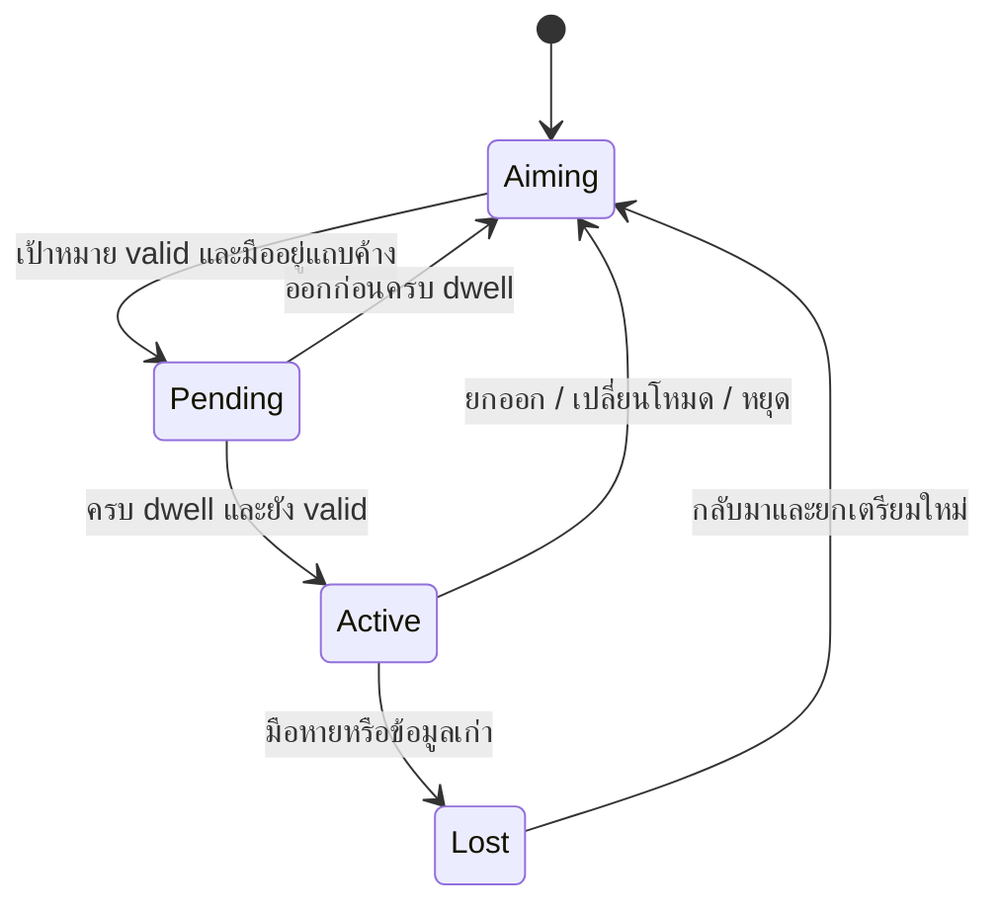

# Ranat Next: เทคนิคระนาดและระบบช่วยบรรเลง

สถานะ: ผลค้นคว้าและข้อเสนอออกแบบ ยังไม่ได้ทำระบบหรือทดสอบเสียงกับครูระนาด

## หลักฐานและข้อจำกัดของคลิป

เปิดลิงก์ผู้ใช้ https://www.youtube.com/watch?v=xq2s9p98MIE แล้วหน้า YouTube แสดงชื่อ “สร้างเกมผี open world ชั่วโมงที่ 2,000 - EP 2” ช่อง Techcast เครื่องมือส่งออก transcript รายงานว่าไม่มี transcript จึงยังไม่อ้างว่าได้ดู/ฟังและตรวจเทคนิคระนาดจากคลิปนี้ ต้องมี timestamp ของช่วงที่ต้องการหรือคลิปที่ตรงก่อนวิเคราะห์รายจังหวะ

เนื้อหาดนตรีด้านล่างสรุปจากสารานุกรมศัพท์ดนตรีไทยและเอกสารการสอน ไม่ใช่ผลถอดคลิป การแปลงท่าทางเป็นปุ่ม/gesture เป็นข้อเสนอผลิตภัณฑ์ ไม่ใช่ท่าบรรเลงจริง

## เทคนิคที่ต้องแยกให้ชัด

| รูปแบบ | ความหมาย/ลักษณะ | การรองรับในแอป |
| --- | --- | --- |
| ตีทีละมือ | เลือกตีซ้ายหรือขวาเป็นครั้ง ๆ | Direct strike แยก track ต่อมือ |
| ตีสลับมือ | ลำดับซ้าย–ขวา ใช้กับรูปแบบดนตรีหลายชนิด | รองรับอิสระ ไม่ถือว่าการสลับทุกครั้งเป็นกรอ |
| ตีพร้อมกันเป็นคู่เสียง | สองลูกดังร่วมกันในจุดจังหวะเดียว | สอง note events มี groupId เดียวกัน |
| คู่แปด | ชื่อโน้ตเดียวกันต่างช่วงเสียง | จับคู่ bar i กับ i+7 เมื่อชุดเสียงเรียงเจ็ดเสียงตามนิยามของ preset |
| ตีเก็บ | ดำเนินทำนองเพิ่มพยางค์ให้ถี่ขึ้น ระนาดเอกมีการฝึกตีเก็บคู่แปด | แยก pattern ทำนองจากความสัมพันธ์คู่เสียง ไม่เรียกการตีคู่แปดหนึ่งครั้งว่าตีเก็บครบความหมาย |
| กรอ | สลับสองมือบนคนละลูกเป็นคู่เสียง ให้เสียงต่อเนื่องสม่ำเสมอ | Hold-to-kro บนคู่เสียงที่กำหนด |
| รัวเสียงเดียว | สองมือสลับบนลูกเดียวอย่างถี่ | Hold-to-roll โดยทั้งสอง voice ใช้ barId เดียวกัน |
| รัวเป็นทำนอง | สลับสองมือเป็นทำนอง ไม่ใช่ค้างโน้ตคู่เดิม | ต้องมีลำดับโน้ต/การเล็งใหม่ ไม่ใช้ loop สองโน้ตแทนทั้งหมด |

กรอมีได้หลายคู่ เช่น คู่ 2, 3, 4, 5, 6 และ 8 ไม่ควรตั้งว่าเสียงที่ไพเราะต้องเป็นคู่แปดเสมอ ความเหมาะสมขึ้นกับทางเพลงและวลี [นิยามกรอ](https://lst.nectec.or.th/encyclopedia/wikipedia/dontri/view/index.php?namelink=กรอ)

รัวเสียงเดียวกับรัวเป็นทำนองมีเงื่อนไขต่างกัน จึงไม่ใช้คำว่า “รัว” แทนทุก pattern ที่ระบบสร้างเสียงถี่ [นิยามรัว](https://lst.nectec.or.th/encyclopedia/wikipedia/dontri/view/index.php?namelink=รัว+๒)

เก็บเป็นลักษณะการดำเนินทำนอง ไม่ได้บอกแค่ว่าตีสองมือพร้อมกัน [นิยามเก็บ](https://lst.nectec.or.th/encyclopedia/wikipedia/dontri/view/index.php?namelink=เก็บ)

เทคนิคตกแต่ง เช่น สะบัด สะเดาะ ขยี้ กวาด และไขว้มือ ควรเป็นระยะต่อไปพร้อมตัวอย่างทางเพลงที่ตรวจแล้ว ไม่สร้างปุ่มสุ่มตกแต่งแล้วตั้งชื่อเป็นเทคนิคดั้งเดิมโดยไม่มีแบบแผน เอกสารสถาบันบัณฑิตพัฒนศิลป์มีการอธิบายกลวิธีเหล่านี้ แต่ครั้งนี้อ่านได้เฉพาะข้อความที่ค้นหาได้ ยังไม่ได้ตรวจ PDF ทั้งฉบับ: https://www.bpi.ac.th/upload/media/2022/05/5167628c5cb9465e3.pdf

## เปลี่ยนโครงสร้างการควบคุมเป็นสามแกนอิสระ

1. Input: touch / keyboard / camera
2. Pitch selection: independent hands / interval lock
3. Articulation: direct / assisted pair / assisted kro / assisted same-note roll

แยกแกนเพื่อให้ “คู่แปด” ใช้ทั้งแบบตีพร้อมและแบบกรอได้ ไม่ทำ octave เป็นเทคนิคที่เลือกแล้วปิดความสามารถกรอ

โหมด Direct หนึ่งท่าตีได้หนึ่งโน้ตต่อมือ ไม่มี auto-repeat เมื่อค้าง โหมด Assisted ต้องเปิดอย่างชัดเจน พร้อมป้ายว่าเสียงบางครั้งสร้างโดยระบบ คะแนนฝึก direct ห้ามใช้ assisted notes มานับเป็นความคล่องมือ

## คู่แปดกับข้อจำกัดเลนส์

Compact 7 ลูกเดิมเล่น octave ด้วยสองปลายภายในช่วงเดียวไม่ได้ เพราะ index ของคู่แปดต่างกัน 7 ต้องครอบคลุม 8 ตำแหน่งเป็นอย่างน้อย

เสนอสามตัวเลือก:

- Direct Compact 8+: ผู้ใช้เลือกสองลูกจริง จำกัดตามคุณภาพกล้อง ไม่รับประกันว่าเลนส์ทุกตัวแม่นพอ
- Assisted Octave: เลือกโน้ตฐานจากพื้นที่เล็ก ระบบแสดงไม้สองอันที่ bar i และ i+7 และสร้างคู่เมื่อ trigger ตามโหมดนี้
- Full: ทั้งสองมือเล็งได้อิสระครบผืนเมื่อสอบเทียบผ่าน

Assisted Octave ต้องใช้ one control owner ที่ผู้ใช้เลือก (มือซ้าย/ขวาหรือ pointer) ในการสร้างหนึ่งคู่ ห้ามรับ trigger จากสองมือแล้วสร้าง octave ซ้ำเป็นสี่เสียง การเคลื่อนไหวของมืออีกข้างไม่สร้างเสียงซ้ำในโหมดนี้

เมื่อเลือกฐานที่ไม่มีคู่สูงในรางให้ target invalid พร้อมแสดงว่าอยู่นอกช่วง อย่า clamp ไปสุดรางจนเปลี่ยนคู่เสียง คู่เสียงทั่วไปกำหนด offset จาก scale degree เช่นคู่ 5 ใช้ offset 4 แต่ความถี่อ่านจาก tuning preset เสมอ ไม่ใช้ offset เป็นจำนวน semitone

## Hold-to-kro ตามความต้องการผู้ใช้

### ขั้นตอนใช้งานแบบสองมือ

1. เปิดโหมด “กรอช่วย” ตั้งคู่เสียงอิสระหรือ interval lock
2. ยกมือในพื้นที่เล็ง เห็นลูกซ้ายและขวาที่จะดังล่วงหน้า ไม่มีเสียงจาก hover
3. ลดมือทั้งสองเข้าแถบค้างที่สอบเทียบไว้และอยู่ครบประมาณ 180ms เริ่มจากมือซ้ายเป็น preset เบื้องต้นที่ต้องให้ครูตรวจ
4. ระบบสร้างซ้าย–ขวาสลับต่อเนื่อง จังหวะเวลาออกจาก audio clock ไม่ต้องรอ gesture ทุกครั้ง
5. ขยับแนวนอนเพื่อเปลี่ยนเป้าหมาย เมื่อ target เสถียรประมาณ 80ms เปลี่ยนคู่พร้อมกันที่ต้นรอบถัดไป ป้องกันครึ่งรอบปนสองคู่
6. ยกมือข้างใดข้างหนึ่งออกจากแถบค้าง หยุดสร้างโน้ตใหม่ทั้ง pattern และปล่อยหางเสียงที่ดังไปแล้ว

โหมดมือเดียวสำหรับ accessibility ใช้ interval lock และ owner เดียว แต่แสดงไม้เสมือนสองข้างและระบุการช่วยชัดเจน

180ms/80ms เป็นค่า prototype ต้องทดลองจริง ไม่ใช่ค่าท่าตีมาตรฐาน เปิดตัวเลือก hold-to-engage โดยไม่มีเสียงตีเริ่มต้นเพื่อลดการตีซ้ำตอนเข้าโหมด; หากจะเพิ่ม attack-on-entry ภายหลังต้อง deduplicate กับโน้ตแรก

### State machine

มือหลุดต้องหยุด scheduling และยกเลิกเสียงที่นัดไว้แต่ยังไม่เริ่มโดยไม่รอ timeout ยาว ผล tracking ที่ล่าช้ามี freshness watchdog แยกจาก animation ห้ามกลับมาเริ่มกรออัตโนมัติหลัง reacquire

### เวลาและ pattern

ใช้เครื่องกำเนิด pattern เดียวสำหรับสองมือ: L R L R ไม่ใช้ timer คนละตัวซึ่งค่อย ๆ เลื่อนเฟสและชนกัน เริ่มทดลองรวม 8–12 strikes/second (แต่ละมือ 4–6) เป็นช่วงทดลองเสียง ไม่ใช่มาตรฐานการกรอจริง ให้ผู้เชี่ยวชาญฟังและปรับตามชุด sample/วลี

มีความเร็วอิสระสำหรับเสียงต่อเนื่อง และตัวเลือกเข้าจังหวะสำหรับแบบฝึก เฉพาะโหมดเข้าจังหวะคำนวณ interval = 60 / (BPM × strikesPerBeat) อย่าบังคับว่ากรอหรือรัวเสียงเดียวทุกชนิดต้อง quantize เป็น 1/16

scheduledAt[k] = startAudioTime + k × interval; hand[k] ตาม parity ของ k; ตั้ง lookahead สั้นประมาณ 40–60ms และเก็บ node ที่นัดไว้เพื่อ cancel ได้เมื่อ stop กรณี scheduler สะดุดให้ข้าม event ที่หมดเวลาแล้ว ไม่ยิงชดเชยเป็นพวง

Direct และ Assisted ใช้ session generation token และ voice ownership เดียวกัน เปลี่ยนโหมดต้อง invalidate งานเก่า หยุด generator เดิม แล้วค่อยรับ input ใหม่ ป้องกัน double sound

## ทำให้เสียงน่าฟังอย่างควบคุมได้

หลักการเล่นจริงที่เอกสารการสอนเน้น ได้แก่ จุดตีที่กลางลูก ความพร้อมของสองมือ น้ำหนักใกล้กัน และความสม่ำเสมอของการกรอ [เอกสารฝึกพื้นฐานจาก BPI](https://media.bpi.ac.th/admin/attach/w2/f20220817115445_HfFVWjUrSP.pdf) (อ้างอิงจากข้อความที่ search อ่านได้)

แปลงเป็นข้อเสนอทางเสียงของระบบ:

- ใช้เสียงระนาดที่ตั้งชุดเดียวกัน ติดข้อมูลแหล่งเสียง/สิทธิ์และให้ครูตรวจ tuning ก่อนออกบทเรียน
- ใช้ samples หลายระดับความดังและหลายตัวอย่างต่อโน้ตเมื่อจัดหาได้ เพื่อลดความรู้สึกเล่นไฟล์เดียวซ้ำ ไม่สุ่ม pitch จนเสียการตั้งเสียง
- Normalize ความดังที่รับรู้ของแต่ละลูกอย่างระวัง ให้กรอสองเสียงไม่กลบกัน ปรับ L/R balance ได้ แต่ไม่ทำให้เสียงทุกลูกมีบุคลิกเหมือนกัน
- ตั้ง loudness/rate แยกกัน ค่าเริ่มต้นปรับด้วย slider ไม่ใช้ความลึกมือควบคุมทุกอย่างพร้อมกัน เพราะทำให้โน้ตและจังหวะสั่น
- มี attack/release ของความดังระดับวลี แต่แต่ละ strike ต้องมี onset ชัด ปล่อยหางเสียงซ้อนตามธรรมชาติ
- ไม่ใส่ timing randomization เป็นค่าเริ่มต้น ความไพเราะจากความสม่ำเสมอและการเว้นวลีสำคัญกว่าการสุ่มให้เหมือนมนุษย์
- Pair assist ยิงสองโน้ตบน audio timestamp เดียวกัน ส่วน Direct เล่นแต่ละมือทันที ไม่หน่วงทุก strike เพื่อรออีกมือ คะแนนพร้อมกันคำนวณภายหลัง
- คู่เสียงของบทเรียนมาจาก arrangement ไม่เดาว่าคู่ 3/5 แบบตะวันตกจะเข้ากับทุกทำนองไทย

## ข้อมูลและการทดสอบที่เพิ่ม

เพิ่ม gesture intent: aim, strike, holdStart, holdMove, holdEnd; performance config: pitchMode, intervalSteps, articulation, owner, rateMode, rate, balance และ assistanceEnabled

บันทึกทั้ง musical events ที่ได้จริง และ metadata ว่า generatedBy=direct/assisted, technique, groupId, patternSessionId, virtualHand, configVersion การฟังย้อนหลังใช้ events ที่บันทึก ไม่ generate ใหม่จาก settings ปัจจุบันจนจังหวะเปลี่ยน

เกณฑ์ทดสอบ:

- octave i→i+7 ถูกต้องทุกฐาน และฐานเกินขอบต้อง invalid
- assisted pair หนึ่ง trigger ได้สอง events เท่านั้น แม้กล้องเห็นสองมือ
- กรอมีลำดับ L/R ต่อเนื่อง ไม่มีสอง timer ยิงชน ไม่มี direct event ซ้อน
- ยกออก/มือหาย/เปลี่ยนช่วง/เปลี่ยนโหมด/ซ่อนแท็บ ยกเลิก scheduled events ที่ยังไม่เริ่ม
- เปลี่ยนคู่ที่รอยต่อรอบ ไม่รีเซ็ตเฟสทุก frame และไม่ติดเสียงเก่า
- ไม่มีโน้ตช่วยถูกนับเป็นการตีมือจริงในคะแนนฝึก
- ให้ครูระนาดฟัง direct คู่แปด, กรอคู่แปด, กรอคู่อื่น และรัวเสียงเดียวแยกกันก่อนใช้คำว่าเลียนแบบเทคนิคได้ถูกต้อง

ลำดับส่งมอบ: direct + คู่แปดช่วย → กรอคู่เสียงช่วย → รัวเสียงเดียวช่วย → รัวเป็นทำนอง/กลวิธีตกแต่งพร้อมเนื้อหาที่ตรวจแล้ว
